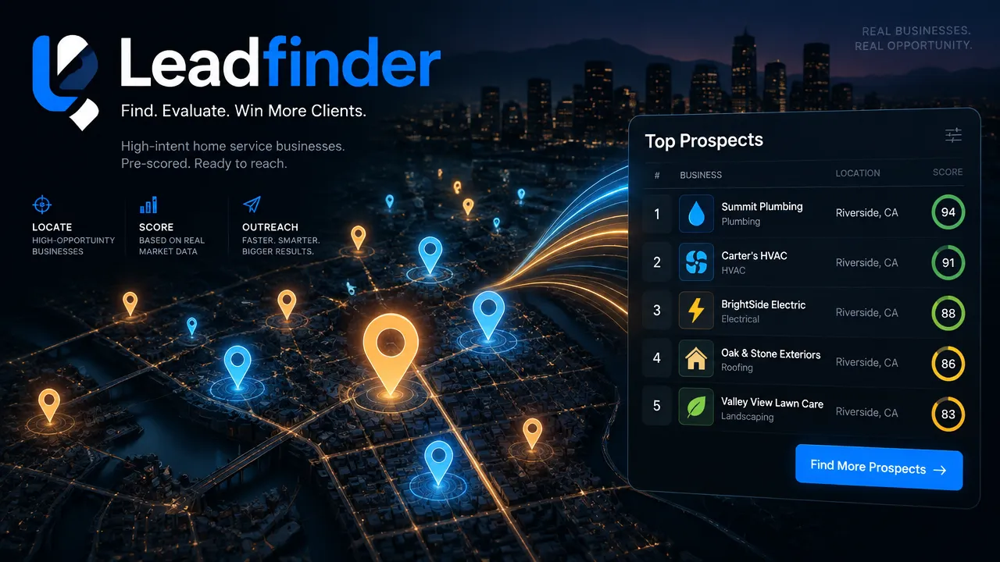

<p align="center">
  
</p>

# Leadfinder

**Find the home-service businesses worth calling, and know what to pitch each one.**

A local prospecting app for a marketing agency that sells to flooring and concrete, painting, fencing and moving companies. It scrapes Google Maps for a market, scores every business for fit with each of your offers, fills in the owner, socials and reviews, and then tracks your outreach.

It runs on your own machine with your own Apify and OpenRouter keys. There is no login and no hosted backend, so don't expose it to the internet.

## How it works

1. **Define a niche.** Start from a preset or from scratch. A niche holds a playbook: which Google Maps categories and keywords count as a target, which chains to exclude, and how to weight each offer.
2. **Draw areas.** Mark a service area on a map as a radius or a polygon. The app lays out the search grid and shows the number of search points, run time and cost before anything is spent.
3. **Launch a run.** After you confirm the estimate, a Google Maps scrape starts on Apify with a hard per-run spend cap. Results are fetched, normalized and deduplicated into one local database. A run can also collect each place's newest reviews, and start the paid searches below, if you tick them.
4. **Review prospects.** A sortable, filterable table (and a map) of everything found, each with a score, a lead offer and a runner-up. Open a business to see exactly why it scored the way it did, with the evidence.
5. **Enrich.** Fill in who owns each business and how to reach them, from free to paid (below).
6. **Work the list.** Log each call: what happened, what you pitched, the objection you heard, and when to follow up. The stage moves on its own. The Outreach page lists follow-ups that are due and tallies objections, and each business has a pitch brief with an opener, the evidence and answers to likely objections.
7. **Decide the gray zone.** Rules sort most businesses into target or noise. The ones they can't decide can be reviewed in a batch by an LLM. Your own decision always wins.

Places are shared across niches, so a business is never scraped or paid for twice. Relevance and score are kept per niche, while contact history and do-not-contact are kept per business.

## Enrichment

"Enrich" on the table runs any of these over **everything your current filters match** (all pages, not just the visible rows, best scores first), after a cost confirmation. The dialog says exactly which filters it covers. With no filter chosen that is targets, adjacent and undecided, never noise. The buttons on a business's page do one business.

| Option | Cost | What it does |
| --- | --- | --- |
| **Quick scan** | Free | Reads the business's own website with plain HTTP, no AI. Finds social links (and links the Facebook page), emails, phone numbers, About and Contact pages, a founder named in structured data, and signals for the offer scores: no mobile site, no contact form or chat, a stale footer, a Facebook Pixel, a DIY site builder, or a site that doesn't load. It records why a site couldn't be read. **Runs on its own** after every Maps run. |
| **Search the web** | About $0.001 | Googles for the owner and has your model read the results. A name is accepted only when a result states it in its own text, and the quotes and sources are shown so you can judge it. Works without a website. |
| **Find Facebook page** | About $0.0005 | Googles the name, city and state plus "Facebook" and picks the page out of the results by matching name, place and phone, with no AI. Saves the page and, when the link carries one, its numeric page ID with a link to check its ads in the Meta Ad Library. A miss is recorded as "searched", never as "has no page". |
| **Fetch reviews** | About $0.002 for the 5 newest | Collects just the chosen places' newest Google reviews by place ID, with no search area, far cheaper than re-running an area. Updates only the review sample and the fresh rating and review count, then rescores every niche that tracks them. |
| **Paid website reader** | About $0.015 | The second pass for sites the quick scan can't read. Also gets emails, phones and services. Never automatic. |

Only the quick scan is automatic. The paid searches (owner names, Facebook pages) are **off unless you tick them** in an area's run setup under "After the run: paid searches". Ticked ones start once the run's places are in, for the first 100 that don't already have the answer, and their cost is in the estimate and the launch confirmation. A result never replaces an owner name you typed, and a stronger finding is never replaced by a weaker one.

Asking a run for the newest reviews ($0.25 per 1,000 reviews) dates each business's last review and shows whether the owner replies. A long gap points to the review-system offer, and a large review base that has gone quiet points to reactivation. A place already in your database gets its review data filled in when a run sees it again.

## The offers

Each prospect is scored 0 to 100 for fit with each of the five things the agency sells:

- Facebook ads
- Speed to lead (AI receptionist and automated texts)
- Database reactivation
- Automated review system
- Website

The highest is the **lead offer** and the next is the **runner-up**. Every score lists its evidence, and anything inferred rather than observed is labelled "(inferred)".

The overall prospect score is a fit gate multiplied by three parts:

```
score = fit gate × (capacity + gaps + reachability)
```

- **Fit gate:** target ×1, undecided ×0.6, adjacent ×0.5, noise or closed ×0.
- **Capacity (max 40):** can they afford a retainer? Reviews, rating, a real website, listed hours.
- **Gaps (max 35):** what is visibly missing? No website, few photos, far fewer reviews than local peers, no hours or booking link.
- **Reachability (max 25):** can you contact them? A phone number and a website.

Peers are compared at ZIP code and category first, then area, then the whole niche, and a comparison needs at least five businesses. Tiers run from A (65 and above) down to D. Trade-level assumptions count for less than facts about the specific business, so the same offer doesn't lead for everyone. Some evidence depends on today's date (how long since the last review), so scores refresh weekly. The weights live in `src/lib/scoring.ts`.

## Roadmap

**Built:** niches and presets, areas and cost-previewed runs, relevance rules plus an LLM gray-zone review, offer-fit scoring with visible evidence, the prospects table, map and detail pages, all of the enrichment above, review recency, and the outreach tracker.

**Not built yet:**

- **Meta Ad Library check.** Whether a Facebook page runs ads. The page and its ID are already saved, but the scoring's Facebook state is still empty.
- **Coverage panel and AI keyword discovery:** cost per new on-target place, saturation, probe runs.
- **Territory guard** for signed clients.
- **Editing by hand:** typing an owner name, or clearing a wrong Facebook match.

## Setup

Requires Node and [pnpm](https://pnpm.io).

```bash
pnpm install
cp .env.example .env.local   # then add your keys
pnpm dev
```

The SQLite database is created at `data/leadfinder.db` and migrated on first request. It is not committed. After you edit `src/db/schema.ts`, run `pnpm db:generate` and commit the new file in `drizzle/`. The dev server holds the database connection open, so restart it after a schema change.

| Env var | Purpose |
| --- | --- |
| `APIFY_TOKEN` | Your Apify API token. Required to launch runs. |
| `APIFY_PLAN` | `free`, `starter`, `scale` or `business`. Picks the per-result rate used for cost estimates. |
| `RUN_COST_CAP_USD` | Hard per-run cap sent to Apify as `maxTotalChargeUsd`. Default 5. |
| `APIFY_MAPS_ACTOR_ID` | Maps scraper. Defaults to `scraperlink/google-maps-scraper`. |
| `APIFY_SEARCH_ACTOR_ID` | Google search actor (owner and Facebook searches). Defaults to `scraperlink/google-search-results-serp-scraper`. |
| `APIFY_ENRICH_ACTOR_ID` | Website-reading actor. Defaults to `menus-r-us/business-profile-enricher`. |
| `AUTO_SCAN_ON_INGEST` | Set to `0` to stop the free quick scan from running after each Maps run. |
| `OPENROUTER_API_KEY` | Your OpenRouter key. Used by the gray-zone review and the owner search. |
| `OPENROUTER_MODEL` | Model used for both. |

To open the dev server from another device on your network, add that device's host to `allowedDevOrigins` in `next.config.ts`.

## Commands

| Command | What it does |
| --- | --- |
| `pnpm dev` | Dev server |
| `pnpm build` / `pnpm start` | Production build and server |
| `pnpm test` | Vitest suite |
| `pnpm lint` | ESLint |
| `pnpm db:generate` | Generate a migration after a schema change |

## Stack

Next.js (App Router) · Tailwind and shadcn · Framer Motion · SQLite through Drizzle · Leaflet with OpenStreetMap · Cheerio · Zod · Vitest.

## Notes

- **The website scan fetches addresses that come from Google listings**, so it refuses private and local addresses (including through redirects), caps page size and time, and limits concurrency.
- `cid` is stored as text. The dataset JSON is pre-processed so 19-digit ids never pass through a JavaScript number.
- Grid points are an estimate of the actor's search centres. `src/lib/geo.test.ts` checks them against the 14 centres from a real run.
- Business photos are stored as Google image URLs, not downloaded. If they stop loading, the app falls back to an initials tile.
- Press **D** to switch between light and dark mode.
- Cache Components is turned off in `next.config.ts` on purpose: every page reads the local database per request.
- Tests run against throwaway SQLite files and stubbed network calls, never your real database or real Apify. (`APIFY_API_BASE`, `OPENROUTER_API_BASE` and `SITE_SCAN_ALLOW_PRIVATE` exist only so tests can point at local stand-ins. Don't set them for real use.)
